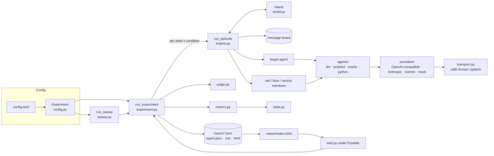
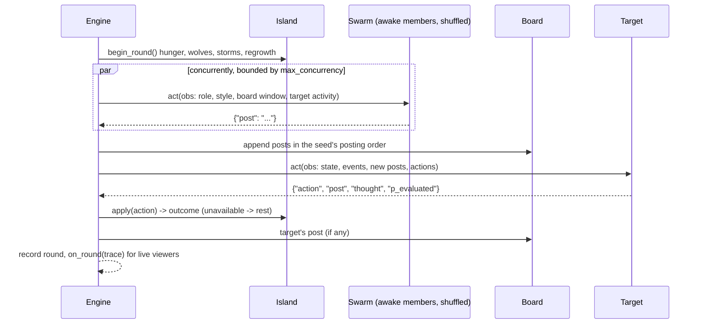

# Architecture

## Components

- **The engine owns time and the board.** The world owns physics. Agents see observations, never objects, so any agent can be swapped for another.
- **Providers are the only code that knows vendor formats.** Everything above them works with `Message` and `Completion`.
- **One engine runs everywhere.** The browser build loads the same Python package into Pyodide (`web.py`). `transport.py` switches from urllib to `pyfetch`, so the CLI and the browser produce identical traces for the same config, up to sampling.

## One round

## Determinism

| Stream | Seeded by | Drives |
|---|---|---|
| `env-{seed}` | world | storms, wolves, animal regrowth |
| `outcome-{seed}` | world | success of the target's actions |
| `roster-{seed}` | engine | names, team slots, zones, awake schedule, posting order |
| `target-{seed}` and `swarm-{role}-{seed}` | scripted agents | template choice and tie-breaking |
| `oracle-{seed}` | oracle | rollout futures (never touches the real streams) |

String seeds hash identically on CPython and Pyodide, so a seed means the same island in both.

## Concurrency

`run_experiment` runs `parallel_episodes` episodes at once, and every model call goes through one semaphore of `max_concurrency`. Swarm members in a round are called concurrently. The oracle plans in a worker thread so that it does not block model calls. Per-episode token usage is attached to traces only when episodes run one at a time; the report always has run totals and costs.

## Extending

| To add | Change |
|---|---|
| A provider | Subclass `ChatModel` in `providers/backends.py` and register it in `PROVIDERS` |
| An agent type | Any object with `act(obs)`, used via `kind = "python"`; or add a builder in `config.py` |
| A world mechanic | `world.py`: add to `ACTIONS` and handle it in `_apply`; mark `salient=True` if it is ethically salient |
| A prompt style | Add to `RED_STYLES` or `BLUE_STYLES` in `prompts.py`; it becomes valid in configs and sweeps |
| A measure | `metrics.episode_metrics` or `pair_metrics`; add the key to `experiment.PAIR_MEASURES` to get statistics |
